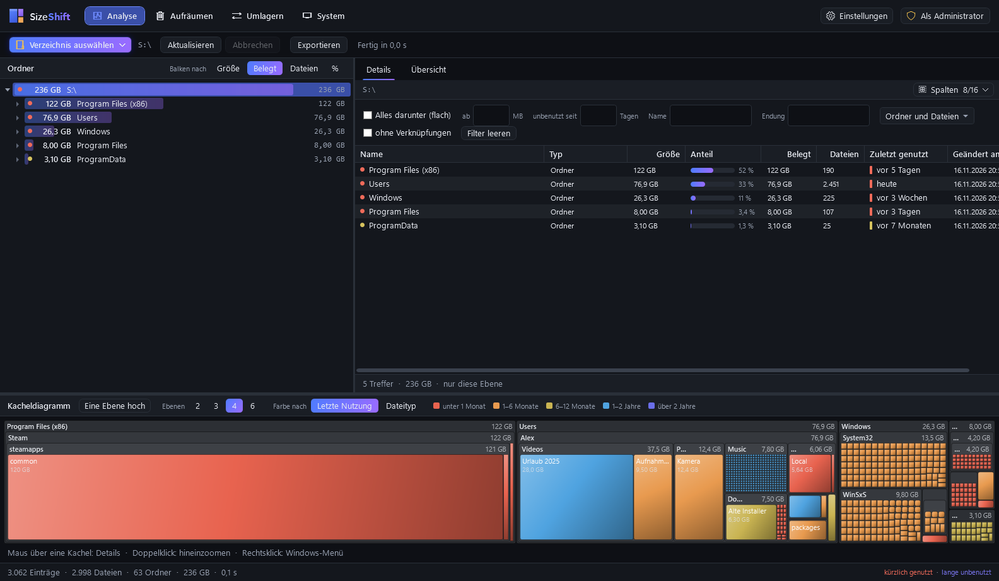
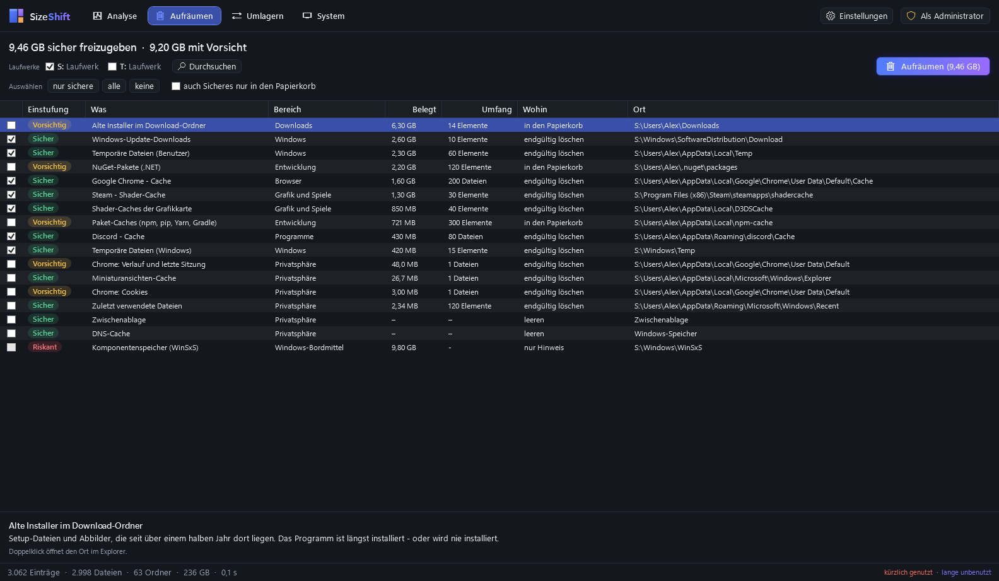
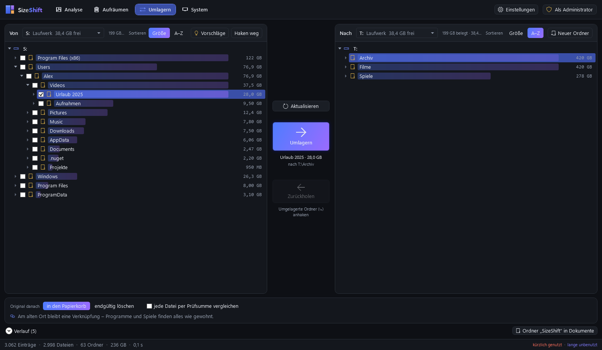
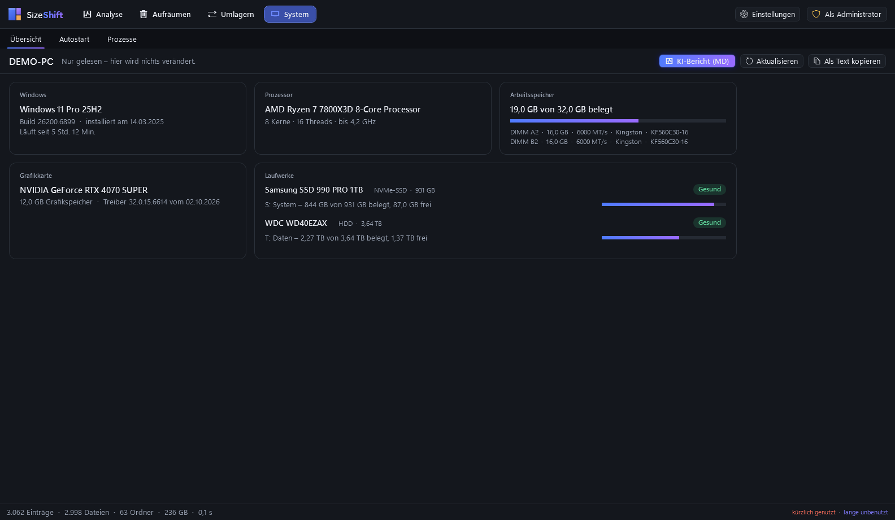
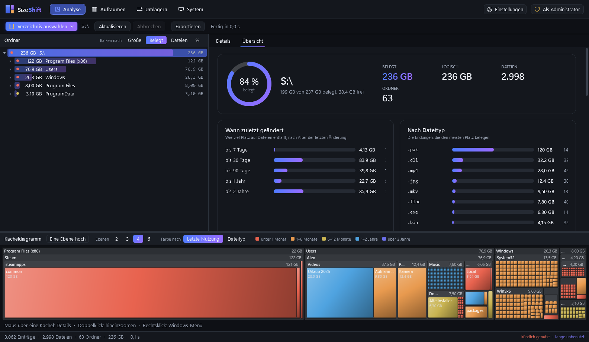
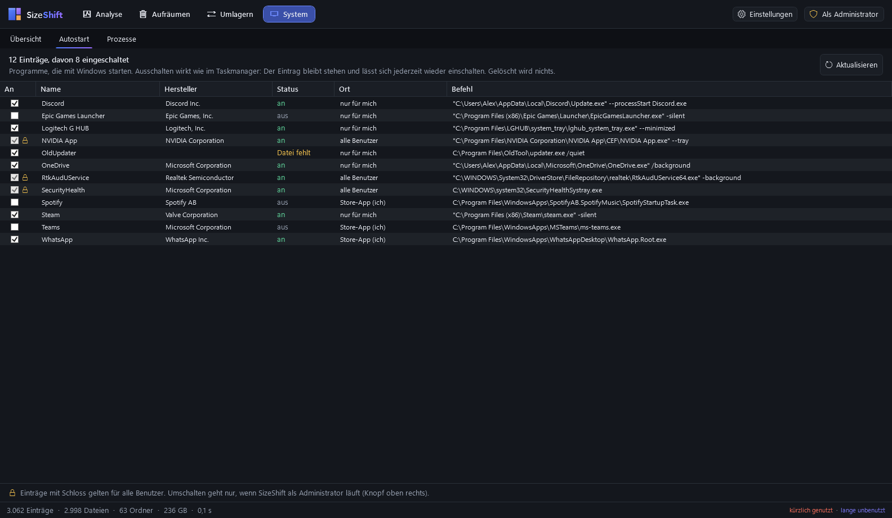
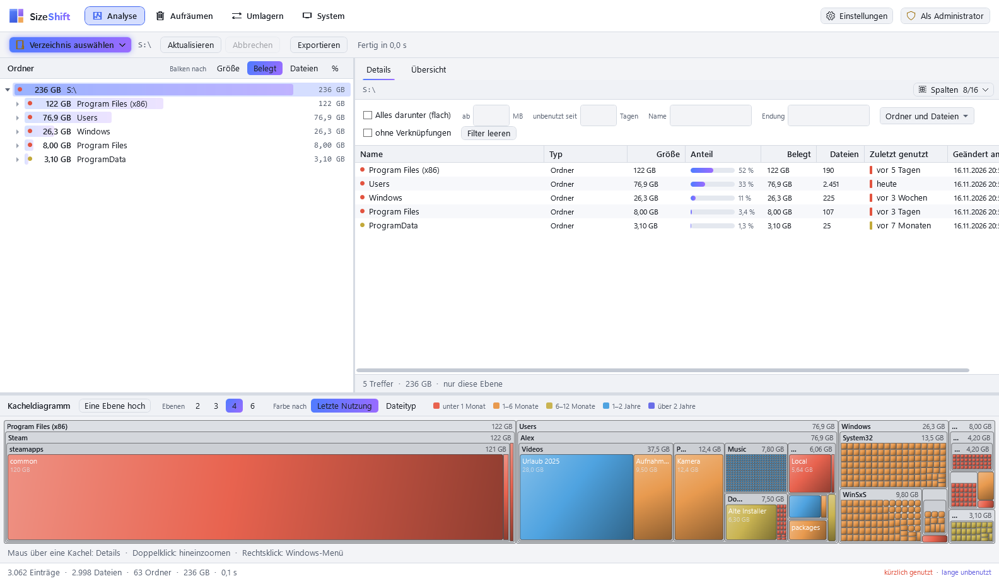
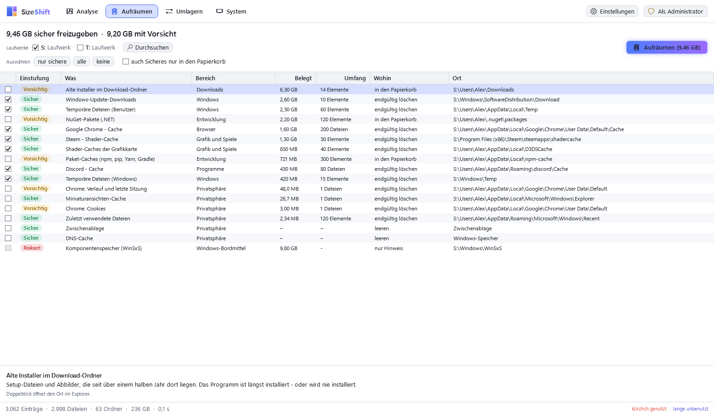
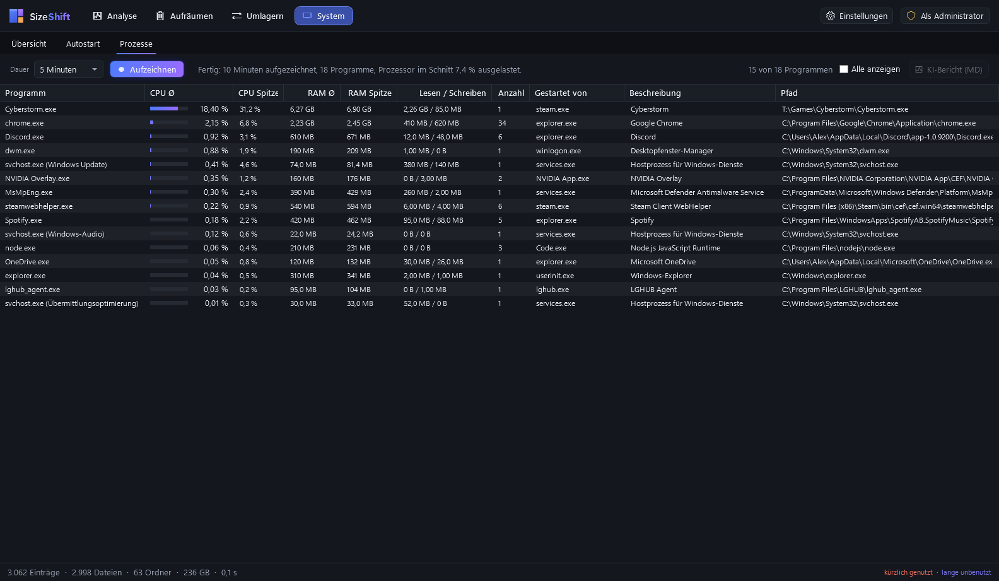
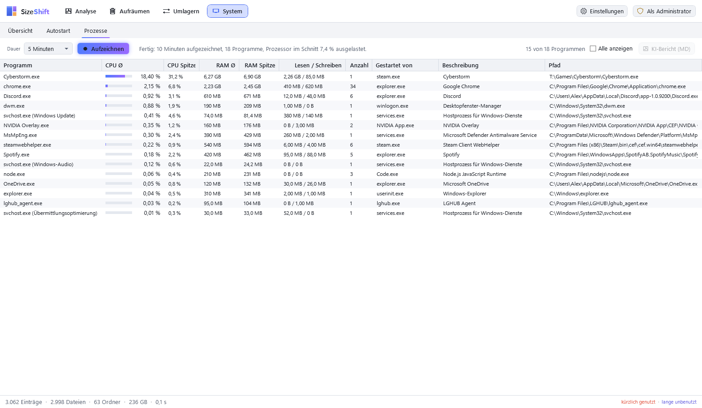

<p align="center">
  
</p>

<h1 align="center">SizeShift</h1>

<p align="center"><a href="README.md">English</a> · <b>Deutsch</b></p>

<p align="center">
  <b>Wo ist der Platz hin?</b><br>
  Festplatten analysieren, aufräumen und große Ordner auf eine andere Platte umlagern – ohne dass Programme und Spiele es merken.
</p>

<p align="center">
  
  
  
  
  
  
  
</p>

> **Mit KI entwickelt.** SizeShift ist mit Hilfe von KI entstanden: Den Code hat größtenteils Claude (Anthropic) in Claude Code geschrieben. Ideen, Entscheidungen und das Testen auf einem echten PC kommen von mir. Jede Version wird mit automatischen Tests geprüft – trotzdem bitte den Abschnitt [Sicherheit](#sicherheit) lesen und, wie bei jedem Werkzeug, das Dateien verschiebt oder löscht, Sicherungen haben.

<p align="center">
  
</p>

> Alle Screenshots zeigen einen **erfundenen Demo-PC**. Sie werden mit `installer\screenshots.ps1` aus Platzhalter-Dateien erzeugt, nicht von einem echten Rechner.

---

## Download

Unter **[Releases](../../releases)** liegt `SizeShift-Setup-<Version>.exe`.

- Installation **ohne Administratorrechte**, nur für den eigenen Benutzer
- Auswahl beim Installieren: Startmenü, Desktop-Verknüpfung, „Mit SizeShift analysieren“ im Rechtsklick
- .NET ist eingebaut – es muss nichts weiter installiert werden
- Deinstallieren über Windows → *Apps*; Verlauf und Exporte bleiben dabei erhalten

> Die Setup-Datei ist nicht digital signiert. Windows SmartScreen meldet deshalb beim ersten Start „Unbekannter Herausgeber“ → *Weitere Informationen* → *Trotzdem ausführen*.

---

## Funktionen

### Analyse
Ordnerbaum mit Größenbalken, Detailtabelle und Kacheldiagramm – wie TreeSize, aber mit Blick auf das **Alter**: wann ein Ordner zuletzt geändert und benutzt wurde.

- Sortieren und filtern nach Größe, Alter, Name, Endung und Typ, Spaltenauswahl („Kompakt“ / „Alle Spalten“)
- Kacheldiagramm, gefärbt nach letzter Nutzung oder Dateityp
- Windows-Kontextmenü per Rechtsklick
- Export nach **Excel**, **CSV**, **JSON** und als kompakter **KI-Bericht** (Markdown) – das Menü zeigt vorher, wie groß die Datei wird
- Als Administrator neu starten, um auch geschützte Systemordner mitzuzählen

### Aufräumen


- Regelkatalog für Temp-Dateien, Browser-, Shader- und Programm-Caches, Windows-Update-Downloads, alte Installer, `node_modules`, Paket-Caches und mehr
- **Mehrere Laufwerke** auf einmal durchsuchen
- Einstufung *Sicher* / *Vorsichtig* / *Riskant*: Sicheres wird endgültig gelöscht (baut sich von selbst neu auf), alles andere geht in den Papierkorb
- **Privatsphäre**: Browser-Verlauf und Cookies (Chrome, Edge, Brave, Firefox), zuletzt verwendete Dateien, Miniaturansichten, Zwischenablage, DNS-Cache – nie vorab angehakt
- Passwörter, Lesezeichen, Erweiterungen und Einstellungen werden **nie** angefasst; ein Test prüft das bei jedem Build
- Läuft der Browser noch, wird die Regel übersprungen statt halb zu löschen

### Umlagern


Große Ordner von C: auf eine andere Platte verschieben. Am alten Ort bleibt eine **Verknüpfung (Junction)** – Programme, Spiele und Launcher finden alles wie gewohnt.

- Zwei Explorer-Bäume: links anhaken, rechts das Ziel wählen, Pfeil → Umlagern
- **Paranoid-Modus**: kopieren (robocopy), jede Datei vergleichen, erst dann die Verknüpfung setzen und testen; das Original kommt in den Papierkorb
- Plan-Dialog vor dem Start mit Prüfung jedes Ordners (Sperrlisten, Platz, laufende Programme, Namenskonflikte)
- **Zurückholen** auf Knopfdruck – auch für Verknüpfungen, die nicht im Verlauf stehen
- Verlauf in `Dokumente\SizeShift\Verlauf`, lesbares Protokoll aller Aktionen

### System


- **Übersicht**: Prozessor, Arbeitsspeicher mit Riegeln, Grafikkarte samt echtem Grafikspeicher und Treiber, Windows-Version, Laufzeit, Datenträger mit Typ (HDD/SSD/NVMe) und Gesundheitsstatus
- **Autostart**: alle Einträge wie im Taskmanager – Registry, Autostart-Ordner und **Store-Apps** – an- und ausschalten, umkehrbar, nichts wird gelöscht
- **Prozesse**: 1 Minute bis 1 Stunde aufzeichnen, was läuft und wie viel Prozessor, Arbeitsspeicher und Festplatte jedes Programm braucht – samt „gestartet von“ und, wie im Taskmanager, jedem Windows-Dienst einzeln; auf Wunsch als KI-Bericht
- **KI-Bericht (MD)**: scannt alle Platten und speichert eine vollständige Bestandsaufnahme (Hardware, größte Ordner je Laufwerk, Aufräum-Funde, Autostart) als Markdown – zum Einfügen in einen KI-Chat

<details>
<summary>Weitere Screenshots</summary>

| | |
|---|---|
|  |  |
|  |  |
|  |  |

</details>

### Außerdem
- **Hell- und Dunkel-Modus**, oder automatisch wie Windows
- **Vier Sprachen**: Deutsch, Englisch, Französisch, Spanisch – standardmäßig die Windows-Sprache
- **Kommandozeile** `sizeshift` für Scans, Exporte, Umlagern, Aufräum-Probelauf, Systeminfos und den KI-Bericht

---

## Sicherheit

SizeShift läuft nur, wenn du es startest. Es gibt **keine Internetverbindung**, **keinen Autostart**, **keine Hintergrunddienste** und **keine geplanten Aufgaben**.

| Aktion | Was passiert | Absicherung |
|---|---|---|
| Scannen, System, KI-Bericht | nur lesen | ändert nichts |
| Aufräumen | löscht angehakte Funde | Bestätigung; Unsicheres in den Papierkorb; Altersgrenze wird beim Löschen erneut geprüft; nie durch Verknüpfungen hindurch |
| Umlagern | kopiert, vergleicht, setzt Verknüpfung | Original erst nach erfolgreichem Vergleich in den Papierkorb; Verlauf mit Zurückholen |
| Autostart | schaltet Einträge an/aus | wie der Taskmanager, der Eintrag selbst bleibt immer stehen |

Gespeichert wird nur:
- `%LOCALAPPDATA%\SizeShift` – Einstellungen (Darstellung, Sprache, Spalten)
- `Dokumente\SizeShift` – Umlager-Verlauf, Protokoll, Exporte, KI-Berichte

---

## Kommandozeile

```text
sizeshift scan <Pfad>                 Größte Ordner und Dateien
sizeshift export <Pfad> --out <Ordner> [--formate xlsx,csv,json,ki]
sizeshift aufraeumen <Pfad>           Aufräum-Funde als Probelauf (löscht nichts)
sizeshift pruefen <Quelle> <Ziel>     Umlagern vorab prüfen
sizeshift umlagern <Quelle> <Ziel>    Umlagern
sizeshift zuruecknehmen <Nr>          Umlagerung rückgängig machen
sizeshift journal                     Verlauf anzeigen
sizeshift system                      Hardware und Windows als Text
sizeshift bericht [Datei]             Kompletter Systembericht als Markdown
sizeshift prozesse [Sekunden] [Datei] Laufende Prozesse aufzeichnen, Bericht als Markdown
```

---

## Selbst bauen

Voraussetzungen: Windows 10/11, [.NET 8 SDK](https://dotnet.microsoft.com/download/dotnet/8.0), für das Setup [Inno Setup 6](https://jrsoftware.org/isinfo.php).

```powershell
dotnet build -c Release                                             # alles bauen
dotnet test tests\TreeSizeBetter.Core.Tests -c Release              # 174 Tests
src\TreeSizeBetter.App\bin\Release\net8.0-windows\SizeShift.exe      # App starten
powershell -ExecutionPolicy Bypass -File installer\build.ps1        # Setup nach artifacts\
powershell -ExecutionPolicy Bypass -File installer\screenshots.ps1  # README-Screenshots (Demo-Daten)
```

### Aufbau

```text
src/TreeSizeBetter.Core   Scanner, Analyse, Aufräum-Regeln, Umlagern, Systeminfos, Export, Sprachen
src/TreeSizeBetter.App    WPF-Oberfläche (MVVM), Themes, Dialoge
src/TreeSizeBetter.Cli    Kommandozeile
tests/                    xUnit-Tests (Autostart nur in einem eigenen Test-Schlüssel)
installer/                Inno-Setup-Skript, Build- und Screenshot-Skript
```

Eine weitere Sprache braucht nur eine weitere Datei in `src/TreeSizeBetter.Core/Localization/` – ein Test prüft, dass alle Sprachen dieselben Schlüssel und Platzhalter haben.

---

## Lizenz

[MIT](LICENSE) – frei nutzen, verändern und weitergeben, auch kommerziell, solange der Copyright-Hinweis erhalten bleibt. Ohne jede Gewährleistung.
