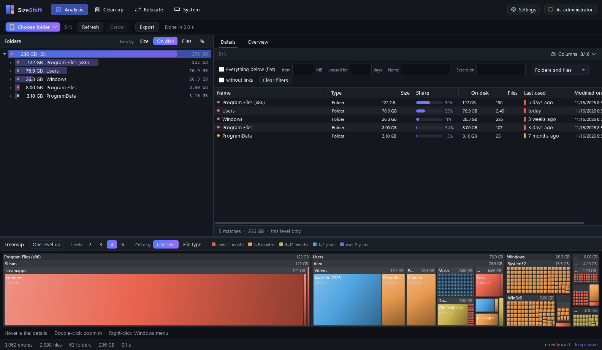
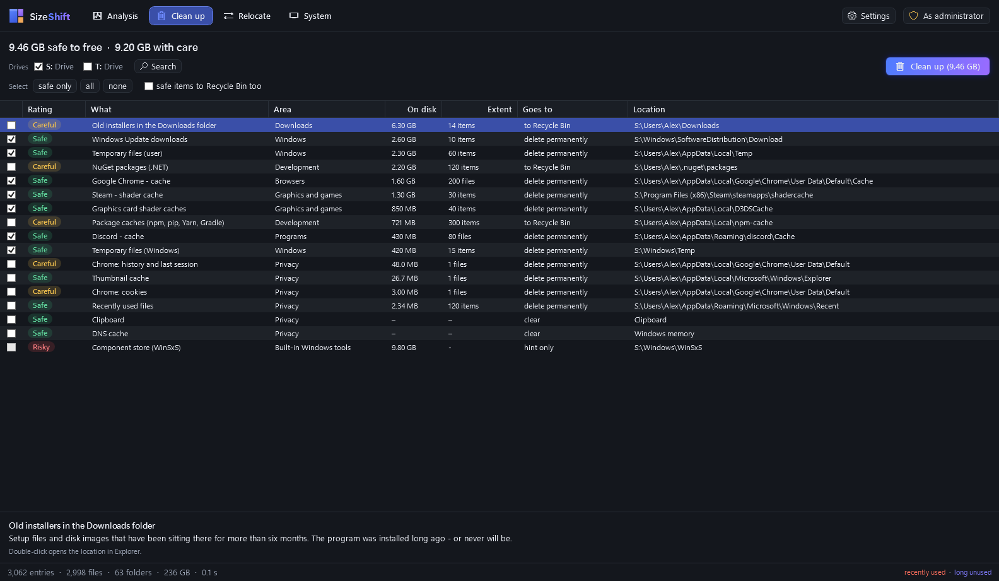
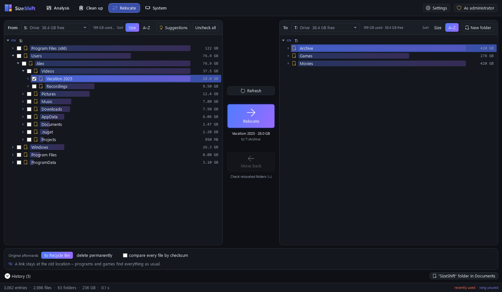
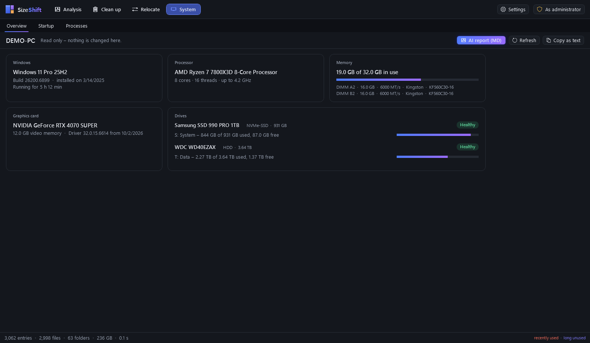
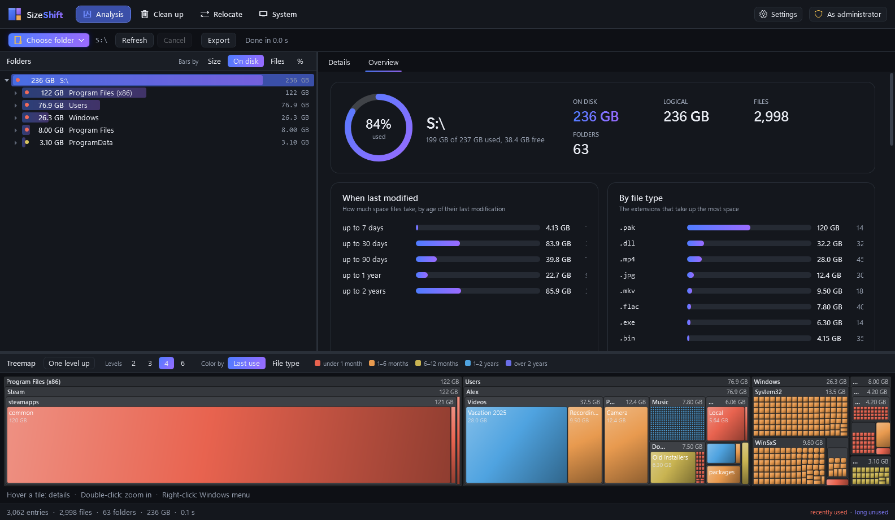
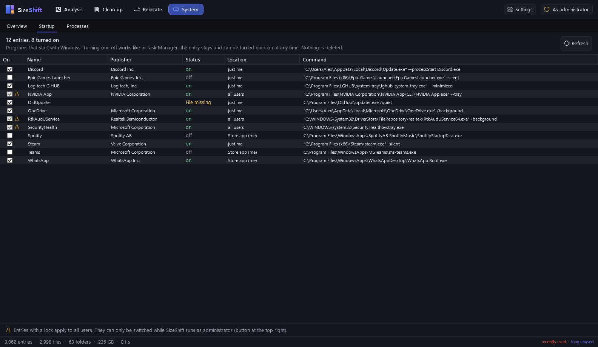
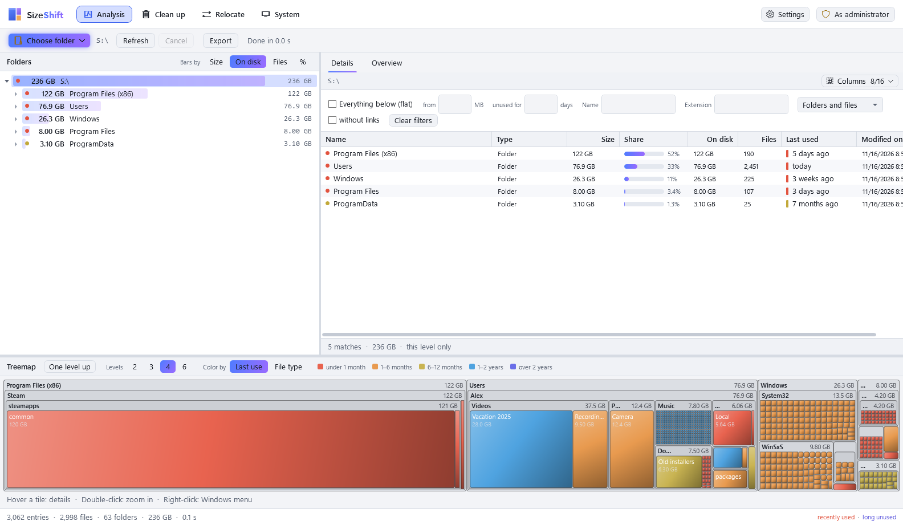
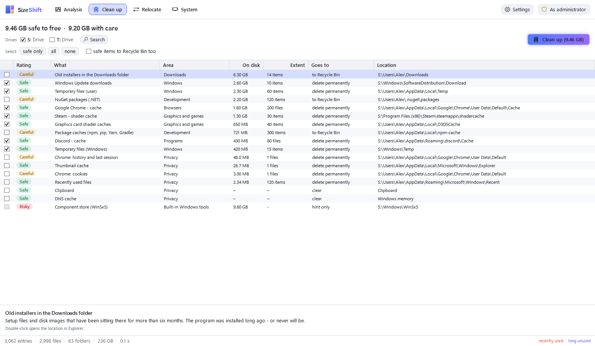
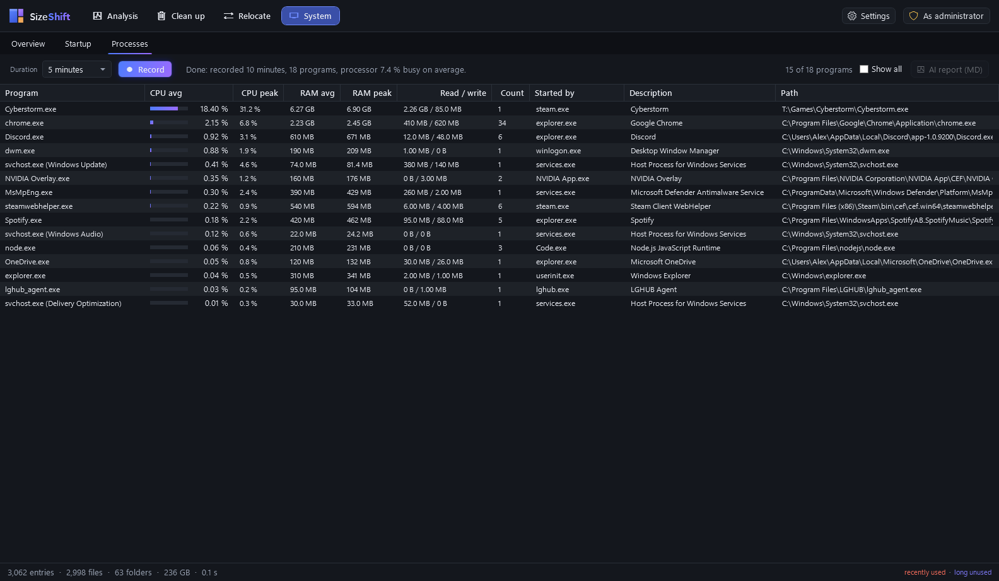
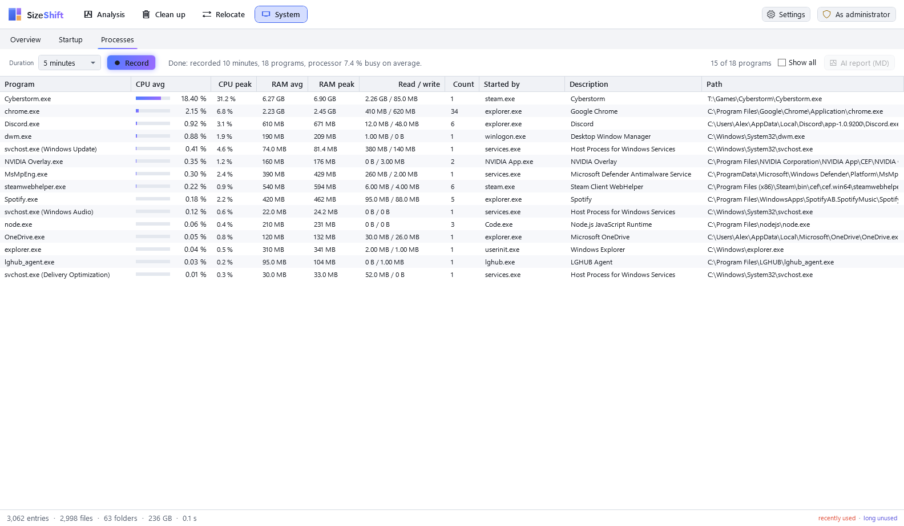

<p align="center">
  
</p>

<h1 align="center">SizeShift</h1>

<p align="center"><b>English</b> · <a href="README.de.md">Deutsch</a></p>

<p align="center">
  <b>Where did all the space go?</b><br>
  Analyze your drives, clean them up and move large folders to another disk – without programs and games noticing.
</p>

<p align="center">
  
  
  
  
  
  
  
</p>

> **Built with AI.** SizeShift was developed with the help of AI: the code was largely written by Claude (Anthropic) in Claude Code. Ideas, decisions and testing on a real PC are my own. Every release is checked with automated tests – but please read the [Safety](#safety) section and keep backups like with any tool that moves or deletes files.

<p align="center">
  
</p>

> All screenshots show an **invented demo PC**. They are generated from placeholder files with `installer\screenshots.ps1`, not taken from a real computer.

---

## Download

Get `SizeShift-Setup-<version>.exe` from **[Releases](../../releases)**.

- Installs **without administrator rights**, for the current user only
- Choose during setup: Start menu, desktop shortcut, “Analyze with SizeShift” in the Explorer right-click menu
- .NET is built in – nothing else to install
- Uninstall via Windows → *Apps*; your history and exports are kept

> The setup is not digitally signed, so Windows SmartScreen shows “Unknown publisher” on first launch → *More info* → *Run anyway*.

---

## Features

### Analysis
Folder tree with size bars, a details table and a treemap – like TreeSize, but with a focus on **age**: when a folder was last changed and last used.

- Sort and filter by size, age, name, extension and type; choose columns (“Compact” / “All columns”)
- Treemap colored by last use or file type
- Windows context menu on right-click
- Export to **Excel**, **CSV**, **JSON** and a compact **AI report** (Markdown) – the menu shows the expected file size before you export
- Restart as administrator to include protected system folders

### Clean up


- Rule catalog for temp files, browser, shader and app caches, Windows Update downloads, old installers, `node_modules`, package caches and more
- Search **several drives** at once
- Ratings *Safe* / *Careful* / *Risky*: safe items are deleted permanently (they rebuild themselves), everything else goes to the Recycle Bin
- **Privacy**: browser history and cookies (Chrome, Edge, Brave, Firefox), recently used files, thumbnails, clipboard, DNS cache – never preselected
- Passwords, bookmarks, extensions and settings are **never** touched; a test checks this on every build
- If the browser is still running, the rule is skipped instead of half-deleting

### Relocate


Move large folders from C: to another disk. A **link (junction)** stays at the old location – programs, games and launchers find everything as before.

- Two Explorer trees: check folders on the left, pick the target on the right, arrow → Relocate
- **Paranoid mode**: copy (robocopy), compare every file, only then set the link and test it; the original goes to the Recycle Bin
- Plan dialog before starting, checking every folder (block lists, free space, running programs, name conflicts)
- **Move back** at the push of a button – even for links that are not in the history
- History in `Documents\SizeShift\Verlauf`, readable log of every action

### System


- **Overview**: processor, memory with modules, graphics card with real video memory and driver, Windows version, uptime, drives with type (HDD/SSD/NVMe) and health status
- **Startup**: every entry as in Task Manager – registry, startup folders and **Store apps** – switch on and off, reversible, nothing is deleted
- **Processes**: record for 1 minute to 1 hour what is running and how much processor, memory and disk each program uses – including who started it and, like Task Manager, every Windows service on its own; saved as an AI report on request
- **AI report (MD)**: scans all disks and saves a complete inventory (hardware, largest folders per drive, cleanup findings, startup) as Markdown – to paste into an AI chat

<details>
<summary>More screenshots</summary>

| | |
|---|---|
|  |  |
|  |  |
|  |  |

</details>

### Also
- **Light and dark mode**, or follow Windows
- **Four languages**: English, German, French, Spanish – the Windows display language by default
- **Command line** `sizeshift` for scans, exports, relocating, a cleanup dry run, system info and the AI report

---

## Safety

SizeShift only runs when you start it. There is **no internet connection**, **no autostart**, **no background service** and **no scheduled task**.

| Action | What happens | Safeguard |
|---|---|---|
| Scan, System, AI report | read only | changes nothing |
| Clean up | deletes checked findings | confirmation; anything not safe goes to the Recycle Bin; the age limit is checked again while deleting; never follows links |
| Relocate | copies, compares, sets a link | original goes to the Recycle Bin only after a successful comparison; history with move back |
| Startup | switches entries on/off | like Task Manager – the entry itself always stays |

The only places SizeShift writes to:
- `%LOCALAPPDATA%\SizeShift` – settings (theme, language, columns)
- `Documents\SizeShift` – relocation history, log, exports, AI reports

---

## Command line

The command names are German; the output follows the selected language.

```text
sizeshift scan <path>                  Largest folders and files
sizeshift export <path> --out <folder> [--formate xlsx,csv,json,ki]
sizeshift aufraeumen <path>            Cleanup findings as a dry run (deletes nothing)
sizeshift pruefen <source> <target>    Check a relocation in advance
sizeshift umlagern <source> <target>   Relocate
sizeshift zuruecknehmen <no>           Undo a relocation
sizeshift journal                      Show the history
sizeshift system                       Hardware and Windows as text
sizeshift bericht [file]               Complete system report as Markdown
sizeshift prozesse [seconds] [file]    Record running processes, report as Markdown
```

---

## Building

Requirements: Windows 10/11, the [.NET 8 SDK](https://dotnet.microsoft.com/download/dotnet/8.0), and [Inno Setup 6](https://jrsoftware.org/isinfo.php) for the installer.

```powershell
dotnet build -c Release                                             # build everything
dotnet test tests\TreeSizeBetter.Core.Tests -c Release              # 174 tests
src\TreeSizeBetter.App\bin\Release\net8.0-windows\SizeShift.exe      # run the app
powershell -ExecutionPolicy Bypass -File installer\build.ps1        # setup into artifacts\
powershell -ExecutionPolicy Bypass -File installer\screenshots.ps1  # README screenshots (demo data)
```

### Structure

```text
src/TreeSizeBetter.Core   Scanner, analysis, cleanup rules, relocation, system info, export, languages
src/TreeSizeBetter.App    WPF user interface (MVVM), themes, dialogs
src/TreeSizeBetter.Cli    Command line
tests/                    xUnit tests (startup tests only use their own test registry key)
installer/                Inno Setup script, build and screenshot scripts
```

Adding a language only takes one more file in `src/TreeSizeBetter.Core/Localization/` – a test checks that every language has the same keys and placeholders.

---

## License

[MIT](LICENSE) – free to use, change and share, including commercially, as long as the copyright notice is kept. The software comes without any warranty.
